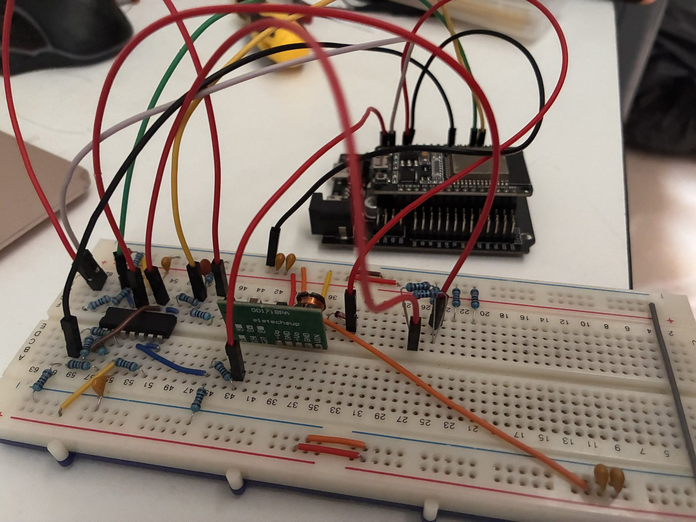
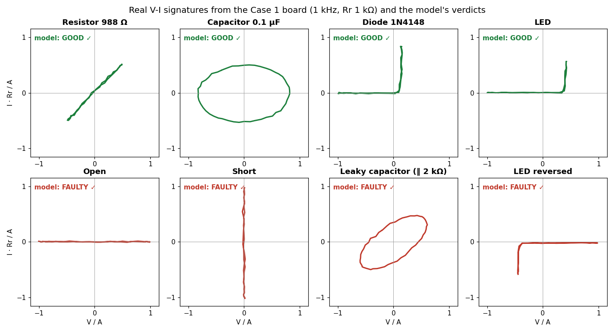
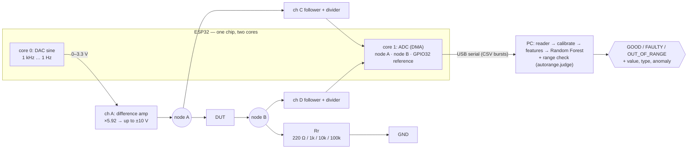
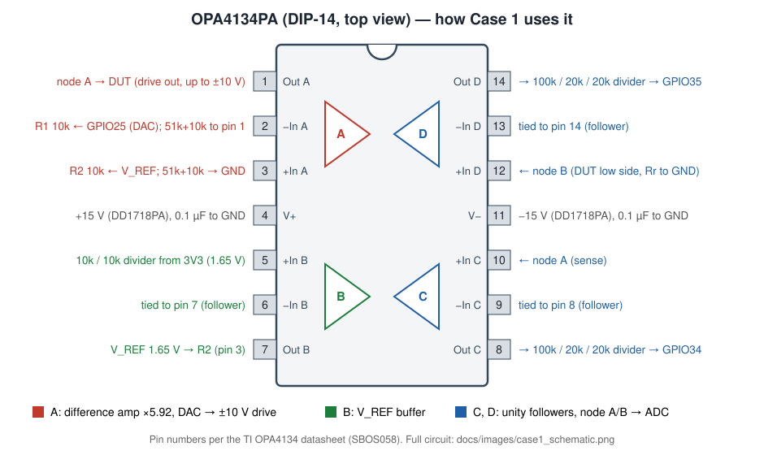
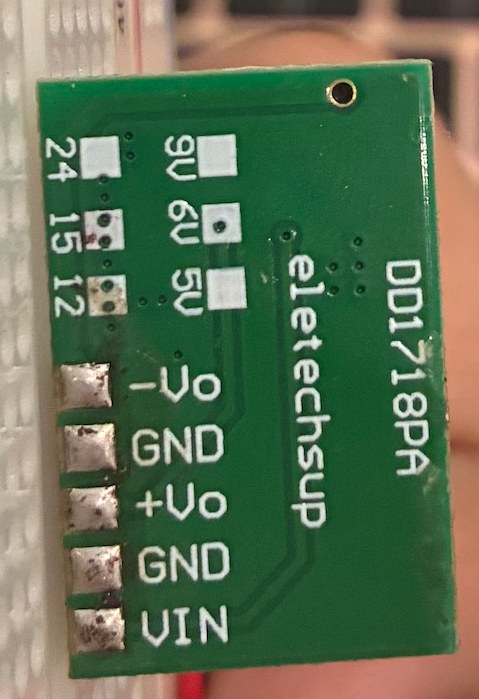
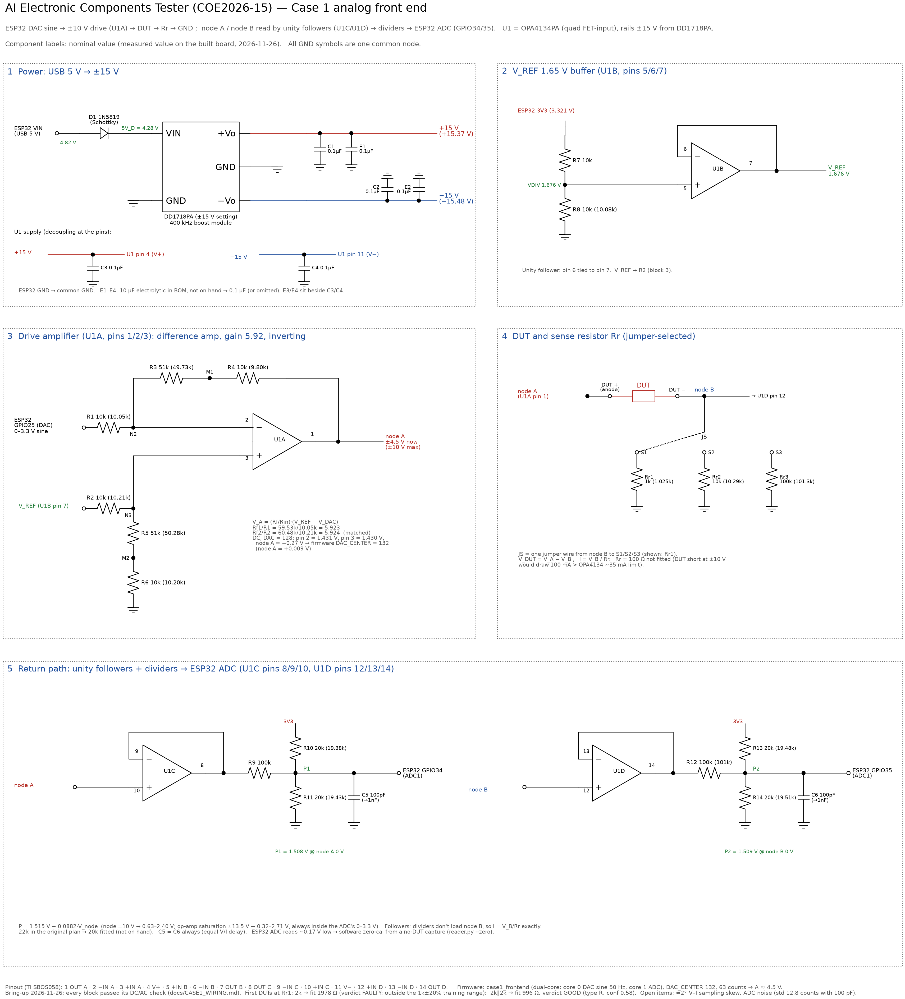

# AI Electronic Components Tester (COE2026-15)

**Is this component good or faulty?** An ESP32-based V-I curve tracer drives the part with a
sine wave and records the voltage-current loop it traces, its **V-I signature**. A
machine-learning model then decides **GOOD / FAULTY** whatever the part's value, and also
names the part type and flags anomalies.


<p align="center">
  
  <br>
  <em>The front end we built on a breadboard: OPA4134PA quad op-amp (left), DD1718PA ±15 V
  module (centre), ESP32 DevKit (back).</em>
</p>

> **New here (human or AI)?** Read [`CLAUDE.md`](CLAUDE.md) first, then [`docs/`](docs/).

## Real signatures from the board



Each panel is a real capture from [`hardware/captures/`](hardware/captures/). It goes through
the same calibrate → features → verify path the model was trained with. The model gets all 52 scored
labelled captures right (`python3 hardware/eval_real.py`). Figure:
`python3 hardware/plot_real_signatures.py`.

## How it works



- **Both ends of the DUT are measured.** The ADC reads node A and node B, so
  V<sub>DUT</sub> = V<sub>A</sub> − V<sub>B</sub> and I = V<sub>B</sub> / Rr. Errors in the
  drive amplifier's gain and offset don't reach the result.
- **The phase comes from the drive.** Both cores share one hardware clock, so every sample is
  labelled with the drive phase. No sync wire is needed.
- **Any value, auto-ranged.** [`hardware/autorange.py`](hardware/autorange.py) picks the drive
  frequency and Rr for each part so that |Z| ≈ Rr. It uses the same rule the training data is
  generated with.
- **Offset drift is cancelled.** A reference divider on GPIO32 is read after every burst. Any
  drift of the ADC offsets since the zero-cal is subtracted automatically.
- **It says when it can't judge.** If |Z|/Rr falls outside what the model was trained on (0.25–4),
  the tester answers **OUT_OF_RANGE** with the measured value, instead of guessing FAULTY.
  Example: a good 10 Ω or 1 MΩ resistor.
- **The model:** 360 points indexed by drive phase, then 14 interpretable features, then a
  Random Forest (health, type) and an Isolation Forest (anomaly). The reasons are in
  [`docs/DESIGN.md`](docs/DESIGN.md).

### OPA4134PA: one chip, four jobs



One quad op-amp does all four jobs, powered from ±15 V:
- channel A drives the DUT;
- channel B holds the 1.65 V reference;
- channels C and D copy node A and node B to the ADC without loading them.

### DD1718PA: ±15 V from the USB 5 V



- **VIN** comes from the ESP32's 5 V (VIN pin) through a 1N5819 Schottky, which blocks
  reverse current. It reads 4.28 V after the diode.
- **+Vo / −Vo** feed op-amp pins 4 and 11. The module is set for ±15 V: it measured
  +15.37 V / −15.98 V unloaded and −15.48 V with the op-amp in. The OPA4134 is rated to ±18 V.
- It switches at ~400 kHz. Each rail therefore gets 0.1 µF right at the op-amp pins, and the
  ADC inputs have a small RC filter (C5/C6).
- All grounds (module, op-amp, ESP32) meet at one point.

<br clear="right">

### Schematic



Values measured on the built board are shown in brackets. Wiring and the 7-step power-up
checks are in [`docs/CASE1_WIRING.md`](docs/CASE1_WIRING.md). The parts list and gain
reasoning are in [`docs/BOM.md`](docs/BOM.md).

## Results so far

| | |
|---|---|
| **Real captures** (`hardware/captures/`) | 52/52 verdicts correct (33 good, 19 faulty). Good: 24 kit resistors 100 Ω – 300 kΩ plus 988 Ω and 2k‖2k (28 captures), 0.1 µF ceramic, 1N4148, LED. Faulty: open, short, reversed diode, reversed LED, leaky C, high-ESR C, degraded diode and LED, built at several severities |
| **Measuring known parts** | 24 resistors of a 1 % kit, 100 Ω – 300 kΩ, auto-ranged: within ±1.5 % of a multimeter. 0.1 µF ceramic → 97–101 nF |
| **Outside the range** | Good 10 Ω, 47 Ω, 470 kΩ and 1 MΩ resistors → OUT_OF_RANGE with the measured value. Open and short → FAULTY |
| **Synthetic set the model never saw** (any value, measured board noise: `python3 vi_ml/eval_synth.py`) | health 97.3 % (good parts called GOOD 98.7 %), type 100 % on good parts, anomaly ROC-AUC 0.82 |

Still open:
- Soft faults are the weakest classes on synthetic data: Zener leak 81 %, shorted turns 83 %,
  high-ESR C 84 %, leaky C 87 %. Hard faults (open, short) are 100 %.
- Not tried on real parts yet: inductors, Zeners and electrolytic capacitors. Electrolytics need
  a lower drive amplitude or a DC bias, which the board doesn't have yet.
- The multi-frequency firmware reads values ~1 % off at 91–333 Hz. The cause isn't known yet.

The live task list is in [`docs/ROADMAP.md`](docs/ROADMAP.md).

## Quick start

No hardware needed:

```bash
pip install -r requirements.txt
cd vi_ml && python3 demo.py        # train + save the models, try a few samples
cd .. && pytest -q                 # invariant tests (188)
python3 hardware/eval_real.py      # the model on the labelled real captures
python3 vi_ml/eval_synth.py        # the synthetic numbers above (~20 s)
```

With the board:
1. Flash [`firmware/esp32/case1/case1_frontend_mf`](firmware/esp32/case1/case1_frontend_mf)
   to an ESP32 DevKit V1 (board "DOIT ESP32 DEVKIT V1", esp32 Arduino core 3.x), e.g.
   `arduino-cli compile --fqbn esp32:esp32:esp32doit-devkit-v1 <sketch folder>`, then
   `arduino-cli upload -p <port>` with the same FQBN and folder.
2. Run `python3 hardware/autorange.py --rr <ohm>`, with the Rr the jumper is on now. It
   measures the part in the DUT spot, picks the frequency and Rr, and prints the value and
   the verdict.

The zero-cal and the full bring-up are described in [`docs/CASE1_WIRING.md`](docs/CASE1_WIRING.md).
`autorange.py` and `collect.py` read the zero-cal from `tools/zero_capture.txt`. `tools/` is
the authors' local workspace and isn't in this repo; without that file they run without the
offset correction.

## Repository layout

```text
vi_ml/            ML pipeline: synth · calibrate · features · train · verify · demo · eval_synth
hardware/         reader.py (serial → raw dict) · autorange.py (auto-range + final answer)
                  collect.py (guided batch capture) · eval_real.py · plot_real_signatures.py
                  demo_r.py · adc_check.py · live demos from the two-board days
  captures/       labelled real captures + labels.csv
  sim/            circuit checks: ngspice/Falstad, breadboard layout and schematic generators
firmware/esp32/   case1/ (the board in use) · dual_core/ · loopback/ · standalone/ · dual_board/ (retired)
tests/            invariant tests (pytest)
docs/             DESIGN · DATA_CONTRACT · ROADMAP · CASE1_WIRING · BOM · PIPELINE_EXPLAINED
                  LITERATURE · STANDALONE_TESTER_PLAN · DAC_ADC_MATH_TH · WORKING_WITH_CLAUDE
```

GitHub's language bar shows about 72 % Python because it counts bytes of source code. All the
PC-side code is Python: the ML pipeline, the reader, auto-range, the circuit generators and the
tests. The firmware is the 11 `.ino` sketches, which GitHub counts as C++ (about 26 %). It
doesn't count captures, docs or images.
